

<picture><source media="(prefers-color-scheme: dark)" srcset="assets/hero-dark.svg"></picture>

<a href="https://github.com/RivnZero?tab=repositories&q=&type=source"><picture><source media="(prefers-color-scheme: dark)" srcset="assets/btn-projects-dark.svg"></picture></a>&nbsp;&nbsp;<a href="https://t.me/theenchant"><picture><source media="(prefers-color-scheme: dark)" srcset="assets/btn-telegram-dark.svg"></picture></a>

 

<picture><source media="(prefers-color-scheme: dark)" srcset="assets/h-projects-dark.svg"></picture>

<a href="https://github.com/RivnZero/telegram-bale-bridge"><picture><source media="(prefers-color-scheme: dark)" srcset="https://raw.githubusercontent.com/RivnZero/RivnZero/output/card-telegram-bale-bridge-dark.svg"></picture></a> 
<a href="https://github.com/RivnZero/statisfy"><picture><source media="(prefers-color-scheme: dark)" srcset="https://raw.githubusercontent.com/RivnZero/RivnZero/output/card-statisfy-dark.svg"></picture></a>&nbsp;<a href="https://github.com/RivnZero/dhook"><picture><source media="(prefers-color-scheme: dark)" srcset="https://raw.githubusercontent.com/RivnZero/RivnZero/output/card-dhook-dark.svg"></picture></a> 
<a href="https://github.com/RivnZero/FREE-MYKET-DOWNLOADER"><picture><source media="(prefers-color-scheme: dark)" srcset="https://raw.githubusercontent.com/RivnZero/RivnZero/output/card-FREE-MYKET-DOWNLOADER-dark.svg"></picture></a>&nbsp;<a href="https://github.com/RivnZero?tab=repositories"><picture><source media="(prefers-color-scheme: dark)" srcset="assets/more-dark.svg"></picture></a>

 

<picture><source media="(prefers-color-scheme: dark)" srcset="assets/h-toolbox-dark.svg"></picture>

<picture><source media="(prefers-color-scheme: dark)" srcset="assets/toolbox-dark.svg"></picture>

 

<picture><source media="(prefers-color-scheme: dark)" srcset="assets/h-activity-dark.svg"></picture>

<picture><source media="(prefers-color-scheme: dark)" srcset="https://raw.githubusercontent.com/RivnZero/RivnZero/output/stats-dark.svg"></picture>

<picture><source media="(prefers-color-scheme: dark)" srcset="https://raw.githubusercontent.com/RivnZero/RivnZero/output/snake-dark.svg"></picture>

 

<picture><source media="(prefers-color-scheme: dark)" srcset="assets/footer-dark.svg"></picture>

